# Paso 1: Configurando el Entorno

## ¡Bienvenido a AgentCon São Paulo 2025! 🎉

¡Hola, futuro ingeniero de agentes! Bienvenido(a) a AgentCon São Paulo 2025, donde darás tus primeros pasos para convertirte en un experto en agentes inteligentes. ¡Estás a punto de embarcarte en la aventura de crear un agente inteligente que puede interactuar con datos, acceder a herramientas y generar increíbles insights por sí solo!

Primero, definamos qué es un **agente inteligente**: es un sistema que puede tomar decisiones, aprender del entorno e interactuar con usuarios u otros sistemas de forma autónoma. En este tutorial, aprenderás a crear un agente inteligente usando .NET y herramientas avanzadas.

Sí, existen agentes más complejos, como los multi-agentes que utilizan Model Context Protocol (MCP), entre otros, pero necesitamos empezar por algún lado, ¿verdad? Si quieres aprender más sobre estos agentes avanzados, consulta nuestra guía sobre IA generativa en .NET [aquí](https://aka.ms/genainet).

## Prerrequisitos
Primero, asegúrate de tener todo listo para comenzar:
- **.NET SDK**: Asegúrate de tener instalado el .NET SDK en tu máquina. Puedes descargarlo [aquí](https://dotnet.microsoft.com/download).
- **Editor de Código**: Recomendamos usar Visual Studio Code o Visual Studio para facilitar el desarrollo. Descarga Visual Studio Code [aquí](https://code.visualstudio.com/).
    - *Opcionalmente*, puedes usar GitHub Codespaces, que te permite programar directamente en el navegador. Accede a Codespaces [aquí](https://github.com/features/codespaces).
- **Cuenta de Azure**: Necesitarás una cuenta de Azure para acceder a Foundry y otras herramientas necesarias. Si aún no tienes una cuenta, créala [aquí](https://azure.microsoft.com/free/). ¡No te preocupes, te daremos créditos gratuitos para comenzar!

## ¿Qué vamos a construir?

En este tutorial, aprenderás a crear un **agente inteligente completo** con:
- 🛠️ **Acceso a herramientas de código y generación de infografías**
- 📚 **RAG (Retrieval-Augmented Generation)** con datos exclusivos de AgentCon
- 🔄 **Capacidad de iteración** para mejorar sus respuestas

## Probando .NET

Primero, asegúrate de que .NET funciona correctamente en tu entorno:

Abre la terminal (*Ctrl + `*) en VSCode o tu terminal preferida y ejecuta el siguiente comando:

```bash
dotnet new console -n MiPrimerAgente
```

Esto creará un nuevo proyecto de consola llamado "MiPrimerAgente". Luego, navega al directorio del proyecto y ejecuta:

```bash
cd MiPrimerAgente
dotnet run
```

Deberías ver el mensaje "Hello, World!" en la terminal.

## Instalando las Bibliotecas Necesarias

Ahora que .NET funciona, necesitamos instalar algunas bibliotecas esenciales para nuestro agente. Abre la terminal en el directorio de tu proyecto y ejecuta los siguientes comandos:

```bash
dotnet add package Azure.AI.Agents.Persistent
dotnet add package Azure.Identity
dotnet add package Microsoft.Extensions.Configuration
dotnet add package Microsoft.Extensions.Configuration.Json
```

Estas bibliotecas nos permiten trabajar con agentes persistentes en Azure, gestionar autenticación y configurar nuestro entorno de desarrollo.

> **Consejo**: Puede que necesites instalar un paquete extra `Microsoft.Extensions.Configuration.Json` para la configuración JSON. Usa el comando:

```bash
dotnet add package Microsoft.Extensions.Configuration.Json
```

## Créditos de Azure
Para asegurarte de tener acceso a los recursos necesarios, vamos a configurar tus créditos de Azure. Si aún no tienes créditos, sigue estos pasos:

Entra al siguiente enlace: [https://aka.ms/JoinEduLab](https://aka.ms/JoinEduLab).

Se te pedirá iniciar sesión en tu cuenta de Azure. Usa la cuenta que creaste anteriormente o inicia sesión con una existente.

Serás dirigido a la página de registro de Azure for Education. Verás una pantalla como esta:

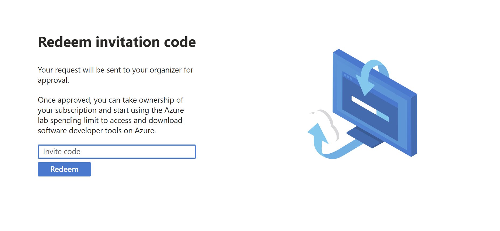

Ingresa el código de invitación proporcionado durante el workshop de AgentCon São Paulo 2025. Tras ingresar el código, serás redirigido a la página de educación, donde podrás ver el estado de tus créditos y recursos disponibles. Si tienes algún problema, avisa al ponente.

> **Importante**: Recibirás un correo para unirte a un tenant de Azure. Asegúrate de aceptar la invitación para tener acceso a los recursos de ese tenant. Requiere MFA (Autenticación Multifactor) para garantizar la seguridad de tu cuenta, así que asegúrate de tener acceso a tu móvil u otro método de autenticación configurado.

> *Muy importante*: Cambia al tenant de Azure for Education si creaste una cuenta de Azure antes de entrar al workshop. Puedes hacerlo haciendo clic en tu foto de perfil en la esquina superior derecha del portal de Azure y seleccionando el tenant correcto.

## Configurando Azure CLI

Si usas GitHub Codespaces, ya tendrás Azure CLI instalado, que es necesario para acceder a los recursos de Azure. Puedes verificar si Azure CLI está instalado ejecutando `az --version` en la terminal. Si no está instalado, sigue las instrucciones de instalación [aquí](https://docs.microsoft.com/cli/azure/install-azure-cli). O usa el comando:
```bash
curl -sL https://aka.ms/InstallAzureCLIDeb | sudo bash
```

## Creando Recursos en Foundry

Con tu cuenta de Azure configurada, vamos a crear los recursos necesarios en AI Foundry para nuestro agente inteligente. AI Foundry es nuestro centro para todos los recursos de IA.

Allí encontrarás herramientas para crear, entrenar e implementar agentes inteligentes, además de acceder a datos, modelos preentrenados, evaluar modelos y hacer pruebas antes de desplegar tus productos con IA.

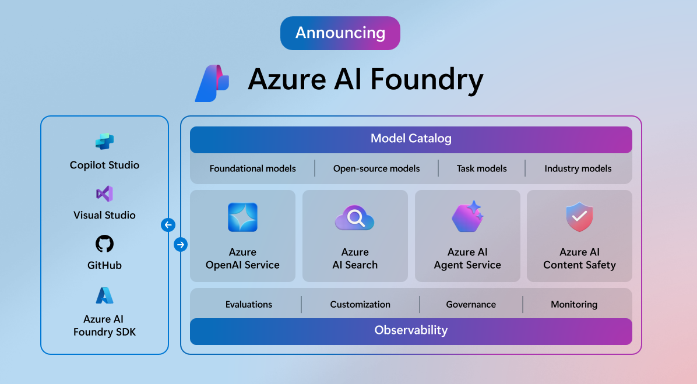

Para acceder a Foundry, ve al portal de Azure y busca "AI Foundry". También puedes acceder directamente: [AI Foundry](https://ai.azure.com).

Verás una pantalla como esta:
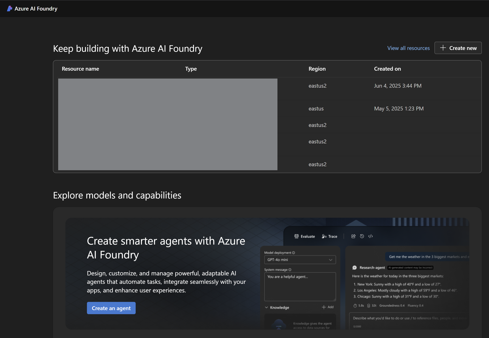

Antes de crear nuestro agente, necesitamos configurar el entorno en Foundry. Cambia el entorno así:
1. Haz clic en el icono de tu nombre en la esquina superior derecha del portal de Azure.
2. Selecciona "Change environment" en el menú desplegable.
3. Elige el entorno "Global Ai" de la lista de entornos disponibles.

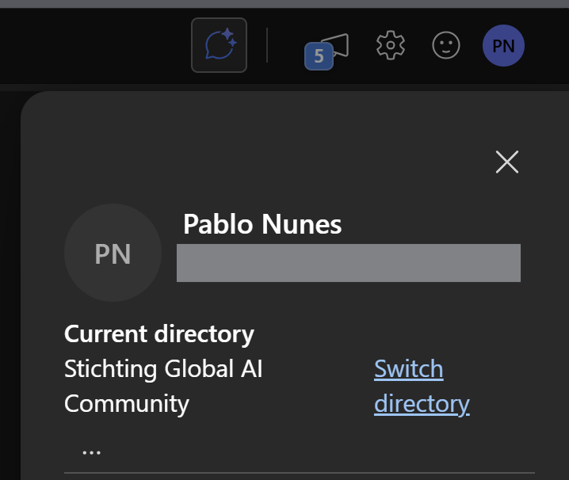
Ahora, necesitamos crear algunos recursos en Foundry, como un proyecto y configurar las credenciales necesarias para acceder a los datos y herramientas que usaremos en nuestro agente.

1. Accede al portal de Foundry, haz clic en "Create new". Si no ves esta opción, haz clic en el botón "Create new agent" en la parte superior de la pantalla.

   

   Aparecerá una pantalla como esta, deja la opción "Azure Ai Foundry Resource" seleccionada y haz clic en "Next":

   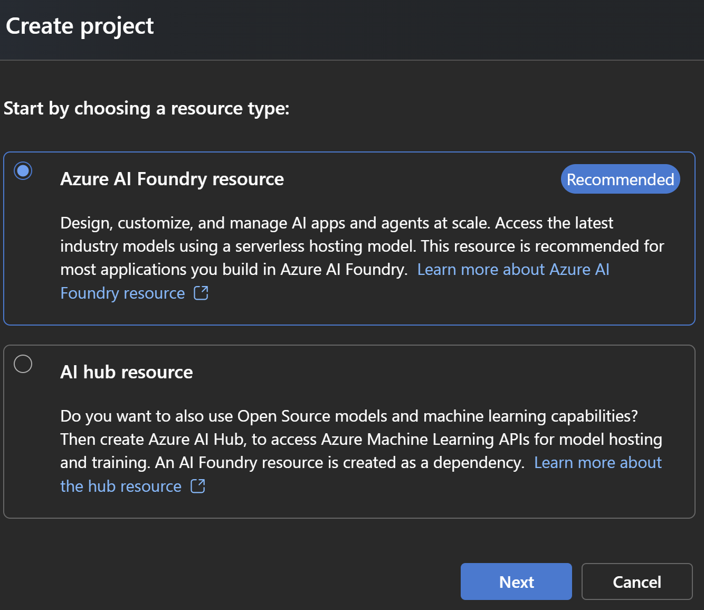

2. Crea un nuevo proyecto, ponle un nombre y un grupo de recursos si lo deseas, en las opciones avanzadas. Recomiendo usar el nombre largo que Foundry te da, como "pablonunes-1523". Haz clic en "Create".

   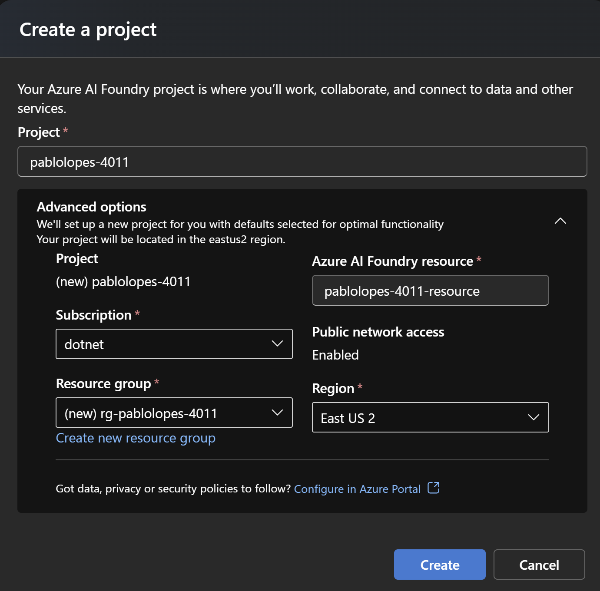

   > **Consejo**: El nombre en Foundry debe ser único globalmente, así que elige un nombre que no esté en uso. Puedes añadir números o letras extra para asegurarlo.

    Verás la pantalla de espera mientras Foundry crea el proyecto:

    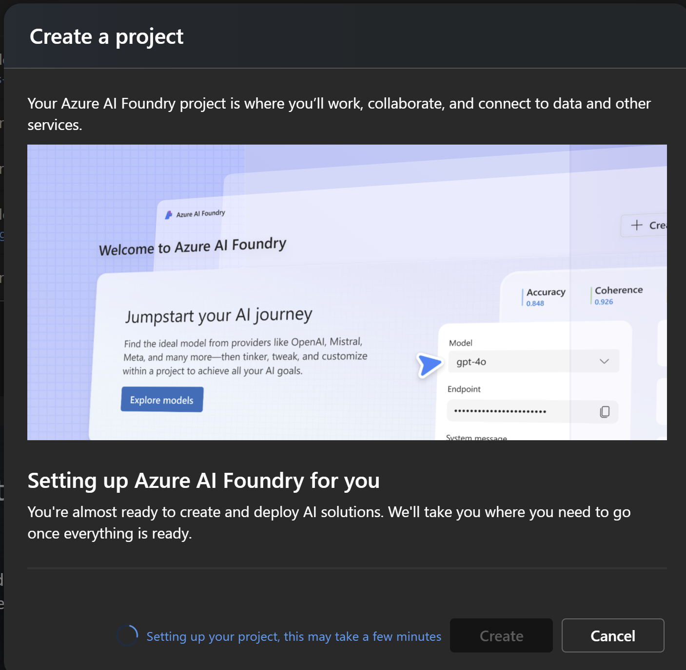

   > **Importante**: Foundry puede tardar unos minutos en crear el proyecto. Ten paciencia y espera hasta que esté listo.

3. Verifica que el proyecto se haya creado correctamente. Verás una pantalla como esta:

    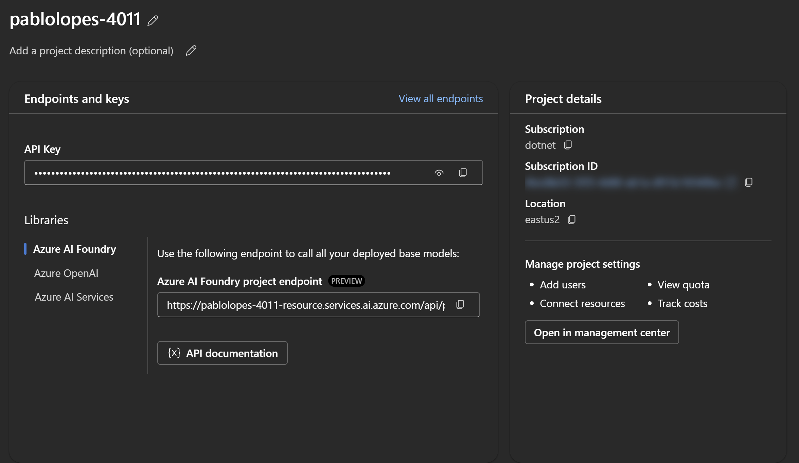
    
    Ahora tienes un proyecto en Foundry donde podrás crear y gestionar tus agentes inteligentes.

    Usaremos el endpoint de Foundry para acceder a los datos y herramientas necesarias para nuestro agente. No necesitaremos usar la clave API, ya que usaremos la autenticación de Azure para acceder a los recursos.

4. Ahora, necesitamos crear el Modelo de Lenguaje Natural que usaremos en nuestro agente. Haz clic en "Models and Endpoints" en el menú lateral izquierdo. Verás una pantalla como esta:

   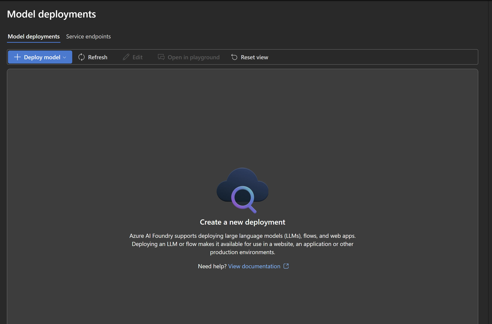

    Luego, haz clic en "Deploy Model" y después en "Deploy Base Model".

   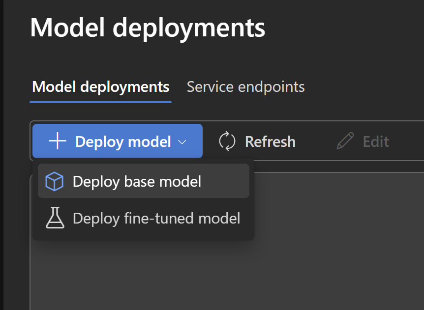

5. Elige el modelo "gpt-4o-mini" y haz clic en "Next". Verás una pantalla como esta:

    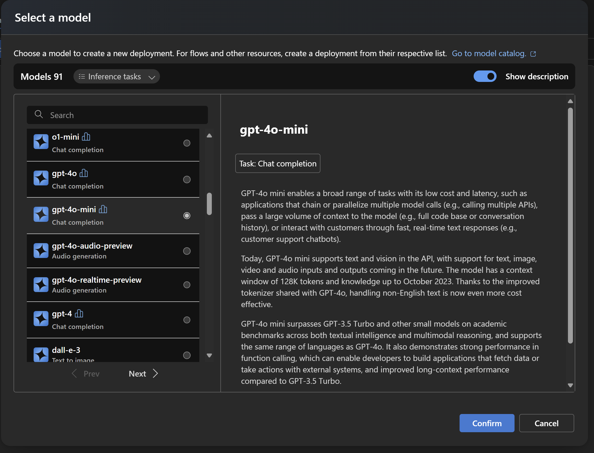

    Después, verás una pantalla de configuración del modelo. Deja las opciones por defecto y haz clic en "Next".

    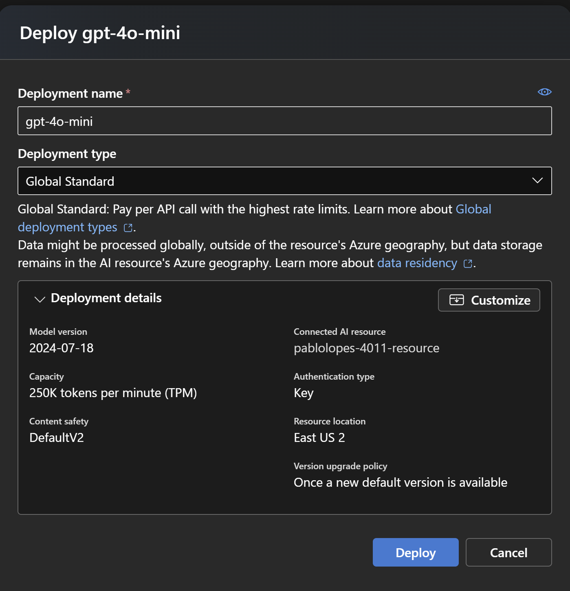

6. Tras crear, verás una pantalla de resumen del modelo. Se mostrarán datos de acceso como el endpoint y el nombre del modelo. Ignora estos, ya que usaremos el endpoint de Foundry que creamos antes.

7. ¡Listo! Ahora tienes un modelo de lenguaje natural configurado en Foundry. Puedes ver el modelo en la lista de modelos y endpoints.

    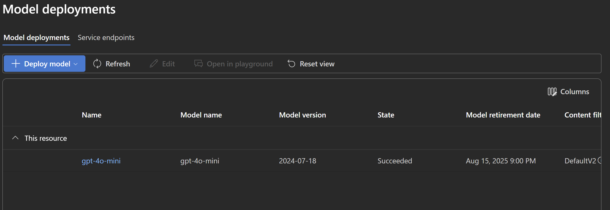

## Próximos Pasos

Con el entorno configurado, ¡estamos listos para empezar a construir nuestro agente! En el siguiente paso, crearemos la estructura básica de nuestro asistente.

Consulta el siguiente paso [aquí](Passo_2.md).

---

✅ **Checkpoint**: Asegúrate de que .NET está funcionando, las bibliotecas están instaladas, tienes créditos disponibles y acceso a Foundry antes de continuar.
